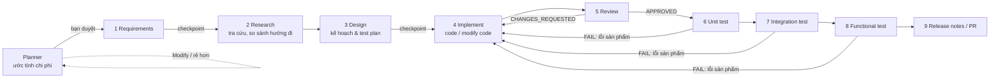

# SDLC Agent SDK: Claude và GitHub Copilot

Bộ SDK chạy **pipeline agent phát triển phần mềm theo vòng đời SDLC**, đi từ requirement đến test chức năng. Pipeline luôn **ước tính chi phí trước và chờ bạn duyệt**. Bạn có thể duyệt, đổi cách làm hoặc huỷ. Khi đã chạy, ngân sách được giới hạn cứng.

Repo có hai bản dùng chung một lõi:

| Bản | Chạy bằng terminal (giới hạn chi phí cứng) | Chạy trong IDE |
|---|---|---|
| **Claude** | `sdlc-claude run` dùng Claude Agent SDK | Claude Code: lệnh `/sdlc` và 9 subagent trong `.claude/agents` |
| **GitHub Copilot** | `sdlc-copilot run` dùng GitHub Copilot SDK | Copilot Chat: prompt `/sdlc` và 10 custom agent trong `.github/agents`, có nút handoff |

## Pipeline



| # | Stage | Agent | Quyền | Model |
|---|---|---|---|---|
| 1 | requirements | `sdlc-analyst`: user story, acceptance criteria Given/When/Then | chỉ ghi report | inherit |
| 2 | research | `sdlc-researcher`: tìm code tái sử dụng, tra docs, so sánh 2–3 phương án, đề xuất 1 | chỉ ghi report | inherit |
| 3 | design | `sdlc-architect`: interface, kế hoạch theo file, test plan theo AC | chỉ ghi report | inherit |
| 4 | implement | `sdlc-developer`: viết mới hoặc sửa code, sửa lỗi review/test | sửa code | inherit |
| 5 | review | `sdlc-reviewer`: đúng/sai, bảo mật, hiệu năng, kết luận `VERDICT` | chỉ ghi report | inherit |
| 6 | unit-test | `sdlc-unit-tester`: test function | sửa test | inherit |
| 7 | integration-test | `sdlc-integration-tester`: test tích hợp | sửa test | inherit |
| 8 | functional-test | `sdlc-functional-tester`: test chức năng theo từng AC | sửa test | inherit |
| 9 | release | `sdlc-release`: mô tả PR, changelog, checklist | chỉ ghi report | inherit |

Mỗi stage ghi report vào `.sdlc/runs/<runId>/NN-<stage>.md`, và stage sau đọc report của các stage trước. Vòng review → sửa và test FAIL → sửa đều có giới hạn số lần (`review.maxIterations`, `test.maxFixIterations`).

## Cấu trúc

```
packages/
  core/      @sdlc/core     lõi dùng chung: stage, ước tính chi phí, cổng duyệt, orchestrator, guard, ledger
    roles/                  9 file định nghĩa agent, là nguồn duy nhất để sinh agent cho cả 2 bản
    src/cli/estimate.ts     CLI sdlc-estimate: plan / approve / verify / record / status
  claude/    @sdlc/claude   ClaudeAdapter (Claude Agent SDK) + CLI sdlc-claude + template .claude/
  copilot/   @sdlc/copilot  CopilotAdapter (GitHub Copilot SDK) + CLI sdlc-copilot + template .github/
examples/demo-app           repo mẫu đã cài cả 2 bản
docs/ARCHITECTURE.md        kiến trúc và cách mở rộng
```

## Cài đặt

```bash
npm install
```

```bash
npm run build
```

```bash
npm test
```

`npm run build` biên dịch 3 package rồi sinh lại agent từ `packages/core/roles` vào cả hai template.

Cài vào một repo thật (ví dụ `~/code/my-app`):

```bash
cd ~/code/my-app && npm i -D /Users/thangqd17/Project/Agent_Management/packages/core /Users/thangqd17/Project/Agent_Management/packages/claude /Users/thangqd17/Project/Agent_Management/packages/copilot
```

```bash
npx sdlc-claude init
```

```bash
npx sdlc-copilot init
```

`init` chép agent, lệnh và prompt vào repo, rồi tạo `sdlc.config.json` nếu repo chưa có. File đã tồn tại được giữ nguyên, trừ khi bạn thêm `--force`. Phần hướng dẫn được **thêm vào cuối** `CLAUDE.md` và `.github/copilot-instructions.md`, không ghi đè nội dung cũ.

## Cổng duyệt chi phí

Không stage nào chạy khi plan chưa được duyệt.

1. **Ước tính.** Công cụ quét repo (số file, token, framework test), đo độ dài requirement và tự xác định độ phức tạp S/M/L/XL. Sau đó nó tính token theo từng stage (số lượt agent, context tăng dần, prompt caching, compaction) rồi nhân với bảng giá của từng model. Kết quả gồm 3 mức **low / expected / high**, cộng thêm chi phí vòng lặp rework. Với Copilot, kết quả còn quy ra **AI credits** (1 credit = $0.01) và % hạn mức gói Pro/Pro+/Max.
2. **Bạn quyết định:**
   - `[a] Approve & run`: chỉ hiện khi mức high nằm trong `budget.maxUsd`.
   - `[m] Modify`: đổi model từng stage, bật/tắt stage, chọn preset `economy` / `balanced` / `quality`, đổi độ phức tạp, ngân sách, số vòng review/test, mode `feature` / `modify` / `bugfix`. Sau mỗi thay đổi, chi phí được ước tính lại ngay.
   - `[s] Save`: lưu plan để duyệt sau, ví dụ cho CI hoặc người khác duyệt.
   - `[c] Cancel`.
3. **Approval gắn với plan và được ký.** `approval.json` lưu hash của requirement, model, stage, ngân sách và bảng giá đã dùng để ước tính. Mỗi approval được ký HMAC bằng key nằm ngoài repo (`~/.config/sdlc/approval.key`, hoặc `$SDLC_HOME`). Nếu plan bị sửa, hoặc file approval bị sửa tay hay giả mạo, `execute` / `verify` sẽ từ chối.
4. **Khi đang chạy:**
   - **Trần cứng**: mỗi stage chỉ được tiêu phần ngân sách đã duyệt còn lại. Bản Claude giới hạn qua `maxBudgetUsd` của SDK. Bản Copilot tự tính chi phí từ sự kiện `assistant.usage` và huỷ session khi chạm trần.
   - Khi chạm trần, pipeline **dừng và hỏi** bạn có duyệt thêm USD không. Mỗi lần duyệt thêm được ghi lại và ký. Mức mới được tính từ số tiền đang giữ trong bộ nhớ, nên agent sửa file cũng không nâng được trần. Trong IDE, gia hạn bằng `sdlc-estimate approve <runId> --extra <usd>`.
   - **Checkpoint mềm**: nếu chi phí thực vượt ước tính quá `overrunTolerance` (mặc định 25%), pipeline hỏi tiếp tục hay dừng.
   - **Checkpoint của người**: sau `requirements` và `design` (`gateAfter: true`), bạn chọn tiếp tục, góp ý để stage làm lại, hoặc dừng.
5. **Tự hiệu chỉnh.** Sau mỗi stage, chi phí ước tính và chi phí thực được ghi vào `.sdlc/ledger.jsonl`. Từ khi một stage có đủ 3 mẫu, lần ước tính sau nhân với trung vị tỉ lệ thực/ước tính của stage đó.

Ở môi trường không tương tác (CI, input qua pipe), cổng **fail-closed**: plan được lưu nhưng không chạy.

## Dùng bản Claude

**Terminal**, có giới hạn chi phí cứng:

```bash
npx sdlc-claude run "Thêm due date và hàm overdue() cho TodoList"
```

```bash
npx sdlc-claude run -f requirement.md --preset economy --mode modify --budget 10
```

Duyệt trước, chạy sau (ví dụ trong CI):

```bash
npx sdlc-estimate plan --target claude "..." && npx sdlc-estimate approve latest && npx sdlc-claude execute latest --no-checkpoints
```

Xác thực giống Claude Agent SDK: `ANTHROPIC_API_KEY` hoặc tài khoản Claude Code đã đăng nhập.

**Trong Claude Code**, gõ `/sdlc <requirement>`. Orchestrator chạy `sdlc-estimate plan`, hiện bảng chi phí, rồi hỏi bằng hộp chọn: *Approve & run / Cheaper plan / Change something / Cancel*. Khi bạn đồng ý, nó ghi approval và gọi lần lượt từng subagent `sdlc-*`. `/sdlc-estimate <requirement>` chỉ ước tính.

## Dùng bản GitHub Copilot

**Terminal:**

```bash
npx sdlc-copilot run "Thêm due date và hàm overdue() cho TodoList"
```

```bash
npx sdlc-copilot models
```

`models` liệt kê model mà tài khoản của bạn dùng được và cho biết model nào đã có giá trong bảng ước tính. Xác thực bằng tài khoản Copilot CLI đã đăng nhập, hoặc `GH_TOKEN` / `GITHUB_TOKEN`.

**Trong Copilot Chat (VS Code)**, gõ `/sdlc`. Agent **sdlc-planner** hiện bảng chi phí, rồi sau khi bạn xác nhận sẽ tự động chạy pipeline từ requirements đến release mà không cần bấm handoff giữa các stage:

- **✅ Approve & start: Requirements**: đây là bước duyệt duy nhất cần xác nhận từ bạn.
- **💰 Re-estimate cheaper** và **✏️ Change the plan**: dùng khi muốn chỉnh phương án chi phí.

Agent của từng stage chạy `sdlc-estimate verify latest` trước khi làm. Nếu plan chưa được duyệt, agent dừng. Sau khi xác nhận, chuyển stage xảy ra tự động theo luồng đã định nghĩa.

## Dùng như thư viện

```ts
import { createPlan, approvalGate, runPipeline, TerminalIO } from "@sdlc/core";
import { ClaudeAdapter } from "@sdlc/claude"; // hoặc: import { CopilotAdapter } from "@sdlc/copilot"

const io = new TerminalIO();
const plan = createPlan({ target: "claude", requirement: "…", repoRoot: "." });
const gate = await approvalGate(plan, io);              // hiện chi phí, chờ duyệt / sửa
if (gate.decision === "approved") {
  await runPipeline(gate.plan, new ClaudeAdapter(), io); // trần cứng = số tiền đã duyệt
}
```

Muốn hỗ trợ một nền tảng khác, chỉ cần viết một class thoả interface `AgentAdapter.runStage()`. Xem [docs/ARCHITECTURE.md](docs/ARCHITECTURE.md).

## Model: dùng model của session, kể cả DeepSeek

Mặc định mọi stage để `model: "inherit"`: agent **không ghim model nào** và chạy bằng model session của bạn.
- **Claude Code / runner Claude:** agent dùng model bạn đang chọn. Nếu bạn dùng backend khác (ví dụ DeepSeek) qua `ANTHROPIC_BASE_URL`, `ANTHROPIC_AUTH_TOKEN` và `ANTHROPIC_MODEL`, agent cũng dùng đúng model đó. File `.claude/agents/*.md` được sinh với `model: inherit`.
- **Copilot Chat:** file `.github/agents/*.agent.md` không có dòng `model`, nên agent dùng model đang chọn trong model picker.
- **Ghim model chỉ khi bạn yêu cầu:** `--model design=claude-opus-5-5`, `--model "*=<id>"` (mọi stage), `--preset economy|balanced|quality`, hoặc khai `stages[].model` trong config. Quay lại mặc định bằng `--preset inherit`.

Bảng chi phí cần một mức giá để tính, nên stage `inherit` được tính theo model "giả định" (`estimateAs`). Thứ tự ưu tiên: `estimateAs` trong config (hoặc `--estimate-as`), rồi `$ANTHROPIC_MODEL` (đã bỏ hậu tố `[1m]`), rồi mặc định `claude-sonnet-5-5` / `claude-sonnet-5.5`.

**Model ngoài bảng giá có sẵn (DeepSeek…):** khai giá (USD cho 1 triệu token) trong `sdlc.config.json`. SDK sẽ **không tự đoán giá**, nếu thiếu giá thì báo lỗi kèm đúng đoạn cần thêm. Các số dưới đây chỉ là ví dụ lấy từ nguồn thứ ba, hãy kiểm tra lại trên trang giá chính thức của DeepSeek:

```json
{
  "estimateAs": { "claude": "deepseek-v4-pro" },
  "prices": {
    "claude": {
      "deepseek-v4-pro":   { "input": 0.435, "output": 0.87, "cacheRead": 0.003625, "cacheWrite": 0.435 },
      "deepseek-v4-flash": { "input": 0.14,  "output": 0.28, "cacheRead": 0.0028,   "cacheWrite": 0.14 }
    }
  }
}
```

Với model có giá khai trong `prices`, bản Claude **tự tính chi phí từ số token** thay vì tin con số của SDK, vì SDK không biết giá của các model này. Nó cũng tự dừng khi chạm trần. Stage chạy trên model Claude có sẵn vẫn dùng số liệu của SDK. Bản Copilot dùng BYOK qua `copilotProvider` (`{ "type": "openai", "baseUrl": "…", "apiKeyEnv": "TEN_BIEN_MOI_TRUONG" }`), khi đó phải ghim model cụ thể thay vì `inherit`.

## Cấu hình: `sdlc.config.json`

File này chỉ chứa phần bạn muốn ghi đè. `init` tạo bản tối giản, **không** chép toàn bộ mặc định vào repo của bạn. Các stage được merge theo `id` với cấu hình mặc định ([packages/core/sdlc.config.default.json](packages/core/sdlc.config.default.json)):

```json
{
  "budget": { "maxUsd": 25, "overrunTolerance": 0.25 },
  "review": { "maxIterations": 2 },
  "test": { "maxFixIterations": 2, "commands": { "unit": "npm test", "integration": "npm run test:int", "functional": "npm run e2e" } },
  "stages": [
    { "id": "implement", "model": { "claude": "claude-opus-5-5", "copilot": "claude-opus-5.5" } },  // ghim model (bỏ dòng này = inherit)
    { "id": "research", "enabled": false }
  ],
  "profiles": { "implement": { "turns": { "S": 12, "M": 30, "L": 50, "XL": 90 } } }
}
```

Bảng giá có sẵn là bản chụp tháng 11/2026: Claude API, và GitHub Copilot usage-based billing (áp dụng từ 01/06/2026). Khi giá thay đổi hoặc bạn dùng model khác, ghi đè bằng `prices` trong config, hoặc trỏ `SDLC_PRICING_FILE=/path/pricing.json` tới file có cùng dạng. Mọi mức giá đều được kiểm tra (số hữu hạn, không âm) và được lưu cố định vào plan khi bạn duyệt.

## An toàn

Bảo vệ được xếp nhiều lớp:

1. **Guard (regex).** Chặn `git push/commit/reset --hard`, `npm/pnpm publish`, `gh release/pr merge`, `sudo`, `curl … | sh`, `rm -rf /`, `terraform/kubectl apply`, việc tự chạy `sdlc-estimate approve`, và việc ghi vào sổ sách pipeline. Stage chỉ-đọc chỉ được chạy lệnh xem (`git diff`, `ls`, `grep`…) và các lệnh test đã cấu hình. Redirect, `$(…)`, `<(…)`, `&`, `find -delete`, `rg --pre`, `git -c`… đều bị chặn.
2. **Đường dẫn.** Các stage chỉ được ghi trong repo. `.git` (mọi biến thể chữ hoa/thường, ở mọi thư mục con), `.env`, `sdlc.config.json` và các file JSON của pipeline bị khoá. Symlink được resolve trước khi kiểm tra. Agent cũng không được đọc `.env` và key ký.
3. **Sandbox OS (bản Claude).** Lệnh Bash chạy trong sandbox của Agent SDK, không ghi được `.git`, sổ sách pipeline, config, và không đọc được key ký. Đặt `sandbox.required: true` để từ chối chạy ở máy không có sandbox.
4. **Approval ký HMAC.** File `approval.json` giả hoặc bị sửa sẽ bị phát hiện.
5. **Token publish** (`GH_TOKEN`, `NPM_TOKEN`…) bị gỡ khỏi môi trường của agent (bản Claude).

Cách áp dụng theo từng môi trường:
- **Runner Claude:** áp cả 5 lớp, qua `canUseTool` và hook `PreToolUse`.
- **Runner Copilot:** áp lớp 1, 2 và 4 qua `onPermissionRequest`. Mọi loại quyền khác (MCP, extension…) đều bị từ chối.
- **Claude Code (IDE):** dùng hook `sdlc-estimate guard-hook` trong `.claude/settings.json`, áp cho mọi agent kể cả subagent. Mỗi lệnh `approve` luôn bật hộp xác nhận cho bạn.

Commit và push luôn do bạn làm.

## Giới hạn đã biết

- **Ước tính chỉ là ước tính.** Profile token là giả định ban đầu, sẽ chính xác hơn sau vài lần chạy nhờ ledger. Chỉ có trần cứng ở runtime mới thực sự bảo đảm chi phí.
- **Chạy trong IDE không có trần cứng.** Claude Code chỉ báo tổng token cho mỗi subagent, nên `record --tokens` quy đổi ra USD gần đúng. Copilot Chat không báo token cho agent, nên chỉ có ước tính và cổng duyệt. Cần trần cứng thì chạy `sdlc-claude run` / `sdlc-copilot run`, hoặc đặt budget AI credits trong GitHub billing.
- **Model không phải Claude (DeepSeek…):** cách chạy và cách tính chi phí ở trên dựa trên tài liệu của SDK và type của nó. Chưa chạy thử với backend DeepSeek thật. Endpoint của DeepSeek theo các nguồn thứ ba không hỗ trợ ảnh, và không chạy song song tool call. Hãy thử một lần với preset nhỏ trước khi dùng thật.
- **Tên model của Copilot** (`claude-sonnet-5.5`…) theo bảng giá GitHub. Hãy kiểm tra bằng `sdlc-copilot models`. Trường `model` trong file `.agent.md` dùng tên hiển thị kiểu `"Claude Sonnet 5.5 (copilot)"`.
- Prompt của agent viết bằng tiếng Anh để model làm việc ổn định nhất. Report vẫn có thể yêu cầu tiếng Việt qua requirement hoặc `CLAUDE.md`.
- **Guard regex chỉ là một lớp.** Một lệnh đủ khéo vẫn có thể lách regex. Vì vậy các lớp sandbox, chữ ký và trần trong bộ nhớ mới là phần bảo đảm. Bản Copilot và Copilot Chat không có sandbox OS. Copilot Chat cũng không có hook guard.
- **Đã chạy thật một lần** (bản Claude, preset economy, demo-app): $0.72 so với ước tính $0.70. Các bản sửa sau đó (sandbox, chữ ký, hook) mới được kiểm chứng bằng 32 unit test và chạy thử hook trên demo-app, **chưa qua một lần chạy thật**. Bản Copilot chưa chạy thật lần nào.
